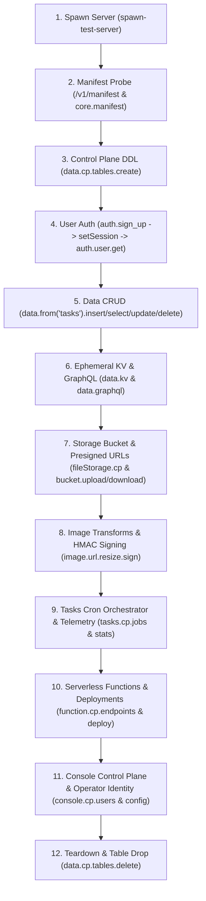

# Layr Client SDK Testing Specification & Coverage Standard (`client-sdk/TESTS.md`)

This document defines the testing architecture, quality invariants, and 100.0% coverage standards required across all 5 Layr client SDK implementations:

- **JavaScript / TypeScript** (`client-sdk/javascript`)
- **Go** (`client-sdk/go`)
- **Python** (`client-sdk/python`)
- **Rust** (`client-sdk/rust`)
- **Swift** (`client-sdk/swift`)

Every SDK implementation must achieve **100.0% test coverage** (statements, branches, functions, and lines) verified by language-native coverage tools:

- **JavaScript / TypeScript**: `vitest run --coverage`
- **Go**: `go test -v -covermode=atomic -coverprofile=coverage.out ./...`
- **Python**: `pytest --cov=layr_client --cov-report=term-missing --cov-fail-under=100`
- **Rust**: `cargo llvm-cov --package layr-client --fail-under-lines 100`
- **Swift**: `swift test --enable-code-coverage`

---

## 1. Multi-Language Testing Architecture & Directory Layouts

Testing across all languages is strictly partitioned into three decoupled tiers:

1. **Tier 1: Unit Tests (Pure Offline Mocks)**:
   - 0 network dependencies. Fast, deterministic, and isolated.
   - Tests URL normalization, header injection, session mutability, fluent QueryBuilder SQL generation, Realtime WebSocket state machine transitions, S3 BucketClient serialization, Image transformation URL construction & HMAC signing, and request parameter encoding / 2xx response decoding for all service methods.
2. **Tier 2: Integration Tests (Wire Contract & Fault Tolerance)**:
   - Tests against simulated HTTP mock servers (e.g. MSW, WireMock, `httptest`).
   - Tests RFC 9457 Problem Details error translation, RFC 6749 OAuth error translation, transient HTTP 429/503 exponential backoff with full jitter, `Retry-After` header parsing, body stream consumption prior to retry, connection timeouts, and credential elevation isolation.
3. **Tier 3: End-to-End Tests (Live Layr Engine)**:
   - Tests against a real, locally running Layr server engine spawned via the global test harness (`./scripts/sdk/spawn-test-server`).
   - Executes full multi-service user journeys (manifest probe -> schema DDL migration -> user registration/login -> table CRUD with Row-Level Security -> realtime CDC event streaming -> object storage upload/download -> image transform).

---

### Language-Specific Directory Layouts (Consistent 4-Tier Architecture)

Every SDK repository strictly adheres to the same 4-layer architecture:

- **Layer 1: Generated OpenAPI Codegen (`generated/`)** — Low-level models and raw route operations generated directly from Go route controllers.
- **Layer 2: Fluent Builders (`extensions/`)** — Value-add extensions (`query_builder`, `bucket_client`, `image_builder`, `realtime`).
- **Layer 3: Client Factory & Services (`core/`, `services/`)** — Unified client context and 8 ergonomic service wrappers (`auth`, `data`, `file_storage`, `image`, `function`, `tasks`, `core`, `console`).
- **Layer 4: Service Account Elevation (`.cp`)** — Administrative and DDL control plane operations attached via service account credentials.

#### 1. JavaScript / TypeScript (`client-sdk/javascript/`)

Toolchain: `pnpm`, `tsdown`, `vitest`

```text
client-sdk/javascript/
├── package.json
├── tsconfig.json
├── tsdown.config.ts
├── vitest.config.ts
├── generated/                    # Layer 1: Raw OpenAPI 3.1 codegen
│   ├── apis/
│   ├── models/
│   └── runtime.ts
├── src/                          # Layers 2, 3, 4: Ergonomic SDK wrapper
│   ├── core/
│   │   ├── client.ts             # LayrClient factory, options, session mutation
│   │   └── transport.ts          # Resilient fetch, headers, retry, backoff, LayrAPIError
│   ├── services/                 # 8 Service wrappers wrapping generated/ APIs
│   │   ├── auth.ts
│   │   ├── data.ts
│   │   ├── file-storage.ts
│   │   ├── image.ts
│   │   ├── function.ts
│   │   ├── tasks.ts
│   │   ├── core.ts
│   │   └── console.ts
│   ├── extensions/               # Layer 2 fluent builders & realtime client
│   │   ├── query-builder.ts      # Fluent SQL query builder
│   │   ├── bucket-client.ts      # S3/object storage bucket client
│   │   ├── image-builder.ts      # URL builder & HMAC signer
│   │   └── realtime.ts           # WebSocket CDC client
│   └── index.ts                  # Public package exports
└── tests/
    ├── unit/
    │   ├── transport.test.ts     # URL normalization, headers, retry, LayrAPIError
    │   ├── client.test.ts        # Client lifecycle, session mutation, .cp elevation
    │   ├── query_builder.test.ts # QueryBuilder SQL projection, filters, mutations
    │   ├── bucket_client.test.ts # Storage bucket upload, download, presign
    │   ├── image_builder.test.ts # Geometry, format, HMAC signing
    │   ├── realtime.test.ts      # WebSocket lifecycle, heartbeat, CDC dispatch
    │   └── services/             # Service method parameter serialization & models
    │       ├── auth.test.ts
    │       ├── data.test.ts
    │       └── ...
    ├── integration/
    │   ├── error_matrix.test.ts  # RFC 9457 & OAuth error mapping
    │   ├── retry_jitter.test.ts  # 429/503 exponential backoff & jitter
    │   └── elevation_isolation.test.ts # Credential segregation & .cp guards
    └── e2e/
        └── lifecycle.test.ts     # Live engine lifecycle test (reads LAYR__SERVER__BASE_URL)
```

#### 2. Go (`client-sdk/go/`)

Toolchain: Go Modules (`go.mod`), standard `go test`

```text
client-sdk/go/
├── go.mod
├── go.sum
├── client.go                     # Public package entrypoint (NewClient, Client, hooks)
├── core/
│   ├── client.go                 # Client struct, configuration options, session mutation
│   ├── transport.go              # Resilient HTTP transport, headers, retry with full jitter
│   └── errors.go                 # LayrAPIError & RFC 9457 Problem Details parser
├── services/                     # 8 Service wrappers wrapping generated/ routes
│   ├── auth.go
│   ├── data.go
│   ├── file_storage.go
│   ├── image.go
│   ├── function.go
│   ├── tasks.go
│   ├── core.go
│   └── console.go
├── extensions/                   # Layer 2 fluent builders & realtime CDC client
│   ├── query_builder.go          # Fluent SQL query builder (data.From)
│   ├── bucket_client.go          # S3/object storage bucket client
│   ├── image_builder.go          # URL transformation builder & HMAC signing
│   └── realtime.go               # WebSocket CDC subscriber
├── generated/                    # Layer 1: Raw OpenAPI 3.1 codegen
│   ├── api_*.go
│   ├── model_*.go
│   ├── client.go
│   └── configuration.go
└── tests/
    ├── unit/
    │   ├── transport_test.go     # URL normalization, headers, retry backoff
    │   ├── client_test.go        # Client factory & session mutability
    │   ├── query_builder_test.go # SQL query builder URL serialization
    │   ├── bucket_test.go        # S3/object storage methods
    │   ├── image_test.go         # Image transformation chain & HMAC signatures
    │   ├── realtime_test.go      # WebSocket state transitions & subscriptions
    │   └── services/             # Service method serialization & response models
    │       ├── auth_test.go
    │       └── data_test.go
    ├── integration/
    │   ├── error_matrix_test.go  # Wire contracts, RFC 9457 error matrix
    │   ├── retry_jitter_test.go  # Retry-After parsing & backoff jitter
    │   └── elevation_isolation_test.go # Service account credential isolation
    └── e2e/
        └── lifecycle_test.go     # Live engine lifecycle test (reads LAYR__SERVER__BASE_URL)
```

#### 3. Python (`client-sdk/python/`)

Toolchain: `pyproject.toml` (uv/poetry), `pytest`

```text
client-sdk/python/
├── pyproject.toml
├── layr_client/                  # Layers 2, 3, 4: Ergonomic SDK wrapper
│   ├── __init__.py               # Exports: create_client, use_data, use_auth...
│   ├── core/
│   │   ├── client.py             # LayrClient, session state, service elevation
│   │   ├── transport.py          # Resilient httpx transport, retry backoff, jitter
│   │   └── exceptions.py         # LayrAPIError, RFC 9457 parser
│   ├── services/                 # 8 Service wrappers wrapping generated/ APIs
│   │   ├── auth.py
│   │   ├── data.py
│   │   ├── file_storage.py
│   │   ├── image.py
│   │   ├── function.py
│   │   ├── tasks.py
│   │   ├── core.py
│   │   └── console.py
│   └── extensions/               # Layer 2 fluent builders
│       ├── query_builder.py      # Fluent QueryBuilder
│       ├── bucket_client.py      # S3/object storage BucketClient
│       ├── image_builder.py      # ImageBuilder with HMAC-SHA256 signing
│       └── realtime.py           # WebSocket CDC client
├── generated/                    # Layer 1: Raw OpenAPI 3.1 codegen
│   ├── api/
│   ├── models/
│   └── api_client.py
└── tests/
    ├── conftest.py               # Shared test fixtures (reads LAYR__SERVER__BASE_URL)
    ├── unit/
    │   ├── test_transport.py     # URL normalization, headers, retry, error parsing
    │   ├── test_client.py        # Client lifecycle, session mutation, .cp elevation
    │   ├── test_query_builder.py # Query builder serialization
    │   ├── test_bucket.py        # Storage bucket operations
    │   ├── test_image.py         # Image URL builder & HMAC signing
    │   ├── test_realtime.py      # WebSocket client, event routing, ping/pong
    │   └── services/             # Service method unit tests
    │       ├── test_auth.py
    │       └── test_data.py
    ├── integration/
    │   ├── test_error_matrix.py  # RFC 9457 error matrix & OAuth mapping
    │   ├── test_retry_jitter.py  # 429/503 exponential backoff & jitter
    │   └── test_elevation_isolation.py # Security header isolation
    └── e2e/
        └── test_lifecycle.py     # Live server end-to-end lifecycle (reads LAYR__SERVER__BASE_URL)
```

#### 4. Rust (`client-sdk/rust/`)

Toolchain: Cargo (`Cargo.toml`), `cargo test`, `cargo llvm-cov`

```text
client-sdk/rust/
├── Cargo.toml
├── generated/                    # Layer 1: Raw OpenAPI 3.1 codegen crate
│   ├── Cargo.toml
│   └── src/
│       ├── apis/
│       └── models/
├── src/                          # Layers 2, 3, 4: Ergonomic SDK crate
│   ├── lib.rs                    # Public exports: create_client, use_data, etc.
│   ├── core/
│   │   ├── mod.rs
│   │   ├── client.rs             # LayrClient, session state, .cp elevation
│   │   ├── transport.rs          # reqwest client, retry, backoff, headers
│   │   └── error.rs              # LayrAPIError, RFC 9457 parsing
│   ├── services/                 # 8 Service wrappers wrapping generated/ routes
│   │   ├── mod.rs
│   │   ├── auth.rs
│   │   ├── data.rs
│   │   ├── file_storage.rs
│   │   ├── image.rs
│   │   ├── function.rs
│   │   ├── tasks.rs
│   │   ├── core.rs
│   │   └── console.rs
│   └── extensions/               # Layer 2 fluent builders
│       ├── mod.rs
│       ├── query_builder.rs      # Fluent QueryBuilder
│       ├── bucket_client.rs      # S3/storage BucketClient
│       ├── image_builder.rs      # ImageBuilder & HMAC-SHA256 signing
│       └── realtime.rs           # WebSocket CDC connection & channels
└── tests/                        # Cargo integration & E2E test targets
    ├── integration_tests.rs      # RFC 9457 error matrix, retry/jitter
    └── e2e_lifecycle.rs          # Live engine lifecycle test (reads LAYR__SERVER__BASE_URL)
```

#### 5. Swift (`client-sdk/swift/`)

Toolchain: Swift Package Manager (`Package.swift`), `swift test`

```text
client-sdk/swift/
├── Package.swift
├── generated/                    # Layer 1: Raw OpenAPI 3.1 codegen
│   ├── Package.swift
│   └── Sources/Generated/
│       ├── APIs/
│       └── Models/
├── Sources/
│   └── LayrClient/               # Layers 2, 3, 4: Ergonomic SDK wrapper
│       ├── LayrClient.swift      # Public module entrypoint
│       ├── Core/
│       │   ├── Client.swift      # Client factory, configuration, session mutation
│       │   ├── Transport.swift   # URLSession transport, retry, headers, jitter
│       │   └── Errors.swift      # LayrAPIError, RFC 9457 parsing
│       ├── Services/             # 8 Service wrappers wrapping generated/ APIs
│       │   ├── AuthService.swift
│       │   ├── DataService.swift
│       │   ├── FileStorageService.swift
│       │   ├── ImageService.swift
│       │   ├── FunctionService.swift
│       │   ├── TasksService.swift
│       │   ├── CoreService.swift
│       │   └── ConsoleService.swift
│       └── Extensions/           # Layer 2 fluent builders
│           ├── QueryBuilder.swift    # Fluent SQL query builder
│           ├── BucketClient.swift    # S3/storage bucket client
│           ├── ImageBuilder.swift    # Image transformation builder & HMAC signing
│           └── RealtimeClient.swift  # URLSessionWebSocketTask CDC client
└── Tests/
    └── LayrClientTests/
        ├── Unit/
        │   ├── TransportTests.swift
        │   ├── ClientTests.swift
        │   ├── QueryBuilderTests.swift
        │   ├── BucketClientTests.swift
        │   ├── ImageBuilderTests.swift
        │   ├── RealtimeTests.swift
        │   └── Services/
        │       ├── AuthServiceTests.swift
        │       └── DataServiceTests.swift
        ├── Integration/
        │   ├── ErrorMatrixTests.swift
        │   ├── RetryJitterTests.swift
        │   └── ElevationIsolationTests.swift
        └── E2E/
            └── LifecycleTests.swift # Live server lifecycle (reads LAYR__SERVER__BASE_URL)
```

---

## 2. Global Test Server Automation Harness (`scripts/sdk/spawn-test-server`)

Rather than re-implementing process spawning and cleanup inside each language's test suite, the repository provides a **single global test server harness** at [scripts/sdk/spawn-test-server](file:///Users/hrdtr/Workspace/Personal/layr/scripts/sdk/spawn-test-server).

Because Layr is an open-source, single-binary engine written in Go, this global harness manages the ephemeral test server for all SDK languages without Docker, external databases, or per-language child-process boilerplate.

### 2.1 CLI Interface

```bash
# Run a test suite with an ephemeral Layr server (auto-spawns, exports LAYR__SERVER__BASE_URL, auto-teardowns)
./scripts/sdk/spawn-test-server [flags] [services...] -- <test-command...>

# Spawn server interactively in foreground
./scripts/sdk/spawn-test-server [flags] [services...]
```

Flags:

- `--port=<port>`: Port number (default: auto ephemeral OS port)
- `--data-dir=<path>`: Data directory (default: isolated temporary directory)
- `--master-encryption-key=<hex>`: 64-hex master encryption key (default: auto test key)
- `--timeout=<seconds>`: Readiness probe timeout in seconds (default: 45)

### 2.2 Test Server Endpoint Injection

The harness configures the Layr engine using canonical configuration variables (`LAYR__SERVER__LISTEN_ADDR`, `LAYR__SERVER__BASE_URL`, `LAYR__DATABASE__URL`, `LAYR__SECURITY__MASTER_ENCRYPTION_KEY`), polls `/v1/manifest` until HTTP 200 is returned, and exports `LAYR__SERVER__BASE_URL` to the test process.

In every language, E2E test suites read the server endpoint directly from `LAYR__SERVER__BASE_URL`:

- **JavaScript / TypeScript**:

  ```typescript
  const endpoint = process.env.LAYR__SERVER__BASE_URL ?? 'http://127.0.0.1:5297';
  ```

- **Go**:

  ```go
  baseURL := os.Getenv("LAYR__SERVER__BASE_URL")
  if baseURL == "" {
      baseURL = "http://127.0.0.1:5297"
  }
  ```

- **Python**:

  ```python
  base_url = os.environ.get("LAYR__SERVER__BASE_URL", "http://127.0.0.1:5297")
  ```

- **Rust**:

  ```rust
  let base_url = std::env::var("LAYR__SERVER__BASE_URL").unwrap_or_else(|_| "http://127.0.0.1:5297".to_string());
  ```

- **Swift**:

  ```swift
  let baseURL = ProcessInfo.processInfo.environment["LAYR__SERVER__BASE_URL"] ?? "http://127.0.0.1:5297"
  ```

### 2.3 Running E2E Tests Across Languages

```bash
# JavaScript / TypeScript E2E
./scripts/sdk/spawn-test-server -- pnpm --dir client-sdk/javascript test:e2e

# Go E2E
./scripts/sdk/spawn-test-server -- go test -v ./client-sdk/go/tests/e2e/...

# Python E2E
./scripts/sdk/spawn-test-server -- pytest client-sdk/python/tests/e2e/

# Rust E2E
./scripts/sdk/spawn-test-server -- cargo test --package layr-client --test e2e_lifecycle

# Swift E2E
./scripts/sdk/spawn-test-server -- swift test --filter LifecycleTests
```

---

## 3. Tier 1: Unit Testing Specification (Pure Offline Mocks)

Unit tests run in isolation with zero network calls. All HTTP/WebSocket transports are mocked with deterministic responses.

### 3.1 Core Transport & URL Normalization

| ID | Test Scenario | Input / Precondition | Expected Behavior / Assertion | Required Branches |
| :--- | :--- | :--- | :--- | :--- |
| `TR-01` | Endpoint Normalization: Default URL | `endpoint: undefined`, `""`, `"   "` | Returns `http://localhost:5297` | Empty, undefined, whitespace inputs |
| `TR-02` | Endpoint Normalization: Trailing Slashes | `http://localhost:5297///` | Returns `http://localhost:5297` | Single and multiple trailing slashes |
| `TR-03` | Endpoint Normalization: Custom Subpath | `https://api.example.com/v1/` | Returns `https://api.example.com/v1` | Preserves custom ports, schemes, and subpaths |
| `TR-04` | Headers: Publishable Key | `publishableKey: "32byteshex..."` | Sets `Publishable-Key: 32byteshex...` | Present vs omitted |
| `TR-05` | Headers: Bearer Token Cleanup | `sessionToken: "Bearer my-jwt"` | Sets `Authorization: Bearer my-jwt` (redundant prefix stripped) | With and without leading `Bearer` |
| `TR-06` | Headers: Empty Session Token | `sessionToken: ""` or `"   "` | `Authorization` header is not set | Empty / whitespace strings |
| `TR-07` | Headers: Service Account Key | `serviceAccountKey: "sec-key"` | Sets `Service-Account-Key: sec-key` | Present vs omitted |
| `TR-08` | Headers: Custom Headers Merge | `{ headers: { "Custom-Header": "val" } }` | Merges custom headers without overwriting security headers | Custom header preservation |

---

### 3.2 Client Context & Session Mutation

| ID | Test Scenario | Input / Precondition | Expected Behavior / Assertion | Required Branches |
| :--- | :--- | :--- | :--- | :--- |
| `CL-01` | Client Factory Initialization | Initializing client with options | Client instantiated with config, options, endpoint | Normal options creation |
| `CL-02` | Session Mutation: `setSession` | Setting active session token | Mutates active session token and `Authorization` header in-place | Bearer prefix stripping |
| `CL-03` | Session Mutation: `clearSession` | Clearing active session | Deletes active session token and removes `Authorization` header | Header deletion |
| `CL-04` | Service Elevation: `.cp` Attachment | Elevating a service with `serviceAccountKey` | Returns elevated object with `.cp` namespace; base service unchanged | Elevation execution |
| `CL-05` | Service Elevation: Optional Key | Options omitted or empty `serviceAccountKey` | Attaches `.cp` namespace without `Service-Account-Key` header | Optional key elevation |
| `CL-06` | Elevation Validation: Invalid Service | Non-service client object passed to elevator | Throws descriptive error: `not a valid Layr service client` | Client presence validation |
| `CL-07` | Elevation Immutability | Inspect base service after elevation | Base service does not expose `.cp` at runtime or in types | Non-mutation of input service |

---

### 3.3 Fluent QueryBuilder

| ID | Test Scenario | Method Call Chain | Expected URL / Body Serialization | Required Branches |
| :--- | :--- | :--- | :--- | :--- |
| `QB-01` | Schema Disambiguation: Default `public` | `data.from('todos')` | `GET /v1/data/public/todos` | Unqualified table name |
| `QB-02` | Schema Disambiguation: Explicit Schema | `data.from('app.todos')` | `GET /v1/data/app/todos` | Dot-qualified table name |
| `QB-03` | Column Projection: Wildcard | `.select('*')` or `.select()` | `?select=*` | Default projection |
| `QB-04` | Column Projection: Comma List | `.select('id, title, status')` | `?select=id%2Ctitle%2Cstatus` | List of columns |
| `QB-05` | Equality Filter | `.eq('status', 'active')` | `?status=eq.active` | `eq` operator |
| `QB-06` | Not Equal Filter | `.neq('status', 'deleted')` | `?status=neq.deleted` | `neq` operator |
| `QB-07` | Comparison Operators | `.gt('age', 18).lt('age', 65)` | `?age=gt.18&age=lt.65` | `gt`, `gte`, `lt`, `lte` |
| `QB-08` | Pattern Matching | `.like('email', '%@corp.com')` | `?email=like.%25%40corp.com` | `like`, `ilike` operators |
| `QB-09` | Null Checking | `.is('deleted_at', null)` | `?deleted_at=is.null` | `is` operator |
| `QB-10` | Set Inclusion | `.in('role', ['admin', 'editor'])` | `?role=in.(admin,editor)` | `in` array formatting |
| `QB-11` | Pagination: Limit & Offset | `.limit(25).offset(50)` | `?limit=25&offset=50` | Numeric pagination |
| `QB-12` | Ordering & Direction | `.order('created_at', { ascending: false, nullsFirst: true })` | `?order=created_at.desc.nullsfirst` | Ordering options |
| `QB-13` | Single Record Modifier | `.single()` | Unwraps single record result; throws if 0 or >1 records returned | Single unwrap branch |
| `QB-14` | Insert Mutation | `.insert({ title: 'New Task' })` | `POST /v1/data/public/todos` with JSON body payload | Insert dispatch |
| `QB-15` | Update Mutation | `.update({ done: true }).eq('id', 1)` | `PATCH /v1/data/public/todos?id=eq.1` with JSON body payload | Update dispatch |
| `QB-16` | Delete Mutation | `.delete().eq('id', 1)` | `DELETE /v1/data/public/todos?id=eq.1` | Delete dispatch |

---

### 3.4 Realtime WebSocket Client

| ID | Test Scenario | Precondition / Action | Expected Event / State Change | Required Branches |
| :--- | :--- | :--- | :--- | :--- |
| `RT-01` | WebSocket URL Derivation: HTTP | `endpoint: 'http://localhost:5297'` | Connects to `ws://localhost:5297/v1/realtime` | HTTP to WS scheme replacement |
| `RT-02` | WebSocket URL Derivation: HTTPS | `endpoint: 'https://api.layr.sh'` | Connects to `wss://api.layr.sh/v1/realtime` | HTTPS to WSS scheme replacement |
| `RT-03` | Authentication Query Parameter | Client has active session token | Connects to `.../v1/realtime?token=<token>` | Token param injection |
| `RT-04` | Channel Subscription | `channel('public:todos').subscribe()` | Sends `{ "event": "subscribe", "topic": "public:todos" }` | Subscribe frame |
| `RT-05` | Event Routing | Incoming `{ "topic": "public:todos", "event": "INSERT", "payload": { ... } }` | Fires registered event callback with payload | Event dispatch lookup |
| `RT-06` | Heartbeat Ping/Pong | Interval timer fires every 30s | Sends `{ "event": "ping" }`; asserts pong received | Heartbeat timer loop |
| `RT-07` | Automatic Reconnection | Connection abruptly drops (abnormal close 1006) | Executes exponential backoff and reconnects | Reconnect backoff state machine |
| `RT-08` | Clean Disconnect | Client disconnect requested | Sends close frame (1000); cancels heartbeat and reconnect timers | Clean teardown |

---

### 3.5 Storage Bucket Client

| ID | Test Scenario | Method Call Chain | Expected Request Serialization | Required Branches |
| :--- | :--- | :--- | :--- | :--- |
| `BK-01` | File Upload: Binary / Buffer / Blob | `storage.from('docs').upload('contract.pdf', bytes, { contentType: 'application/pdf' })` | `PUT /v1/file-storage/objects/docs/contract.pdf` with `Content-Type: application/pdf` and raw body | Content-Type inference |
| `BK-02` | File Download | `storage.from('docs').download('contract.pdf')` | `GET /v1/file-storage/objects/docs/contract.pdf` returning byte stream or blob | Binary download response |
| `BK-03` | File Metadata | `storage.from('docs').head('contract.pdf')` | `HEAD /v1/file-storage/objects/docs/contract.pdf` returning parsed headers | Metadata head response |
| `BK-04` | File Deletion | `storage.from('docs').delete('contract.pdf')` | `DELETE /v1/file-storage/objects/docs/contract.pdf` | Delete dispatch |
| `BK-05` | Presigned URL Generation | `storage.from('docs').createPresignedURL('contract.pdf', { operation: 'read', expiresInSeconds: 3600 })` | `POST /v1/file-storage/url/presign` with `{ "bucket": "docs", "key": "contract.pdf", "operation": "read", "expires_in_seconds": 3600 }` | Options with operation and expiresInSeconds |

---

### 3.6 Image URL Builder

| ID | Test Scenario | Method Call Chain | Expected Serialized URL | Required Branches |
| :--- | :--- | :--- | :--- | :--- |
| `IM-01` | Geometry: Resize | `image.url('photo.jpg').resize({ width: 800, height: 600, fit: 'fill' })` | `.../v1/image/_/rs:fill:800:600/plain/photo.jpg` | Dimension options |
| `IM-02` | Format & Compression | `.format('webp').quality(85)` | `.../v1/image/_/f:webp/q:85/plain/photo.jpg` | Format and quality options |
| `IM-03` | Filters: Blur & Rotate | `.blur(2.5).rotate(90)` | `.../v1/image/_/bl:2.5/rot:90/plain/photo.jpg` | Blur sigma and degrees |
| `IM-04` | Orientation: Flip & Flop | `.flip().flop()` | `.../v1/image/_/flip:1/flop:1/plain/photo.jpg` | Flip and flop flags |
| `IM-05` | Cryptographic HMAC Signing | `.resize({ width: 300 }).sign('my-hmac-key', 'my-salt')` | Computes HMAC-SHA256 of `salt + path`, replaces `_` with base64url signature | Signature generator logic |

---

### 3.7 Service Methods Unit Test Specification

For every service method across all 8 services (`auth`, `core`, `data`, `file_storage`, `image`, `function`, `tasks`, `console`), unit tests must assert the following 8 test invariants:

| ID | Test Scenario | Precondition / Input | Expected Assertion | Required Coverage Branches |
| :--- | :--- | :--- | :--- | :--- |
| `SVC-01` | Path Parameter Interpolation | Method called with path params (e.g. `{id}`, `{bucket}`) | Parameters are safely URL-encoded into target request path | Special characters in path params |
| `SVC-02` | Query Parameter Serialization | Method called with optional and required query params | Serializes into URL query string with correct parameter naming | Present vs omitted query params |
| `SVC-03` | Request Body JSON Serialization | Method called with typed payload object | Serializes to JSON string; sets `Content-Type: application/json` | Required and optional fields |
| `SVC-04` | Successful 2xx Deserialization | Mock returns HTTP 200/201 with valid JSON body | Parses response into strongly-typed SDK return model | Field mappings and date parsing |
| `SVC-05` | Void / 204 No Content Handling | Mock returns HTTP 204 No Content with empty body | Completes without attempting to parse JSON; returns `void` | Empty body branch |
| `SVC-06` | RFC 9457 Problem Details Error | Mock returns HTTP 400, 403, 404, 409, 422, or 500 JSON | Throws `LayrAPIError` preserving `.status`, `.title`, `.detail`, `.instance` | Problem Details parser branch |
| `SVC-07` | RFC 6749 OAuth 2.0 Error | Mock returns HTTP 401 with `{ "error": "...", "error_description": "..." }` | Throws `LayrAPIError` preserving OAuth error fields | OAuth error parser branch |
| `SVC-08` | Elevation Header Enforcement | Calling a `.cp.*` method | Validates presence of `Service-Account-Key` header; fails if missing | Elevated vs base client headers |

---

## 4. Tier 2: Integration Testing Specification (Wire Contract & Fault Tolerance)

Integration tests run against simulated HTTP mock servers (e.g. MSW, WireMock, `httptest`) to validate transport resilience and protocol compliance.

### 4.1 Error Matrix & Status Handling (`error_matrix`)

| ID | Status Code | Content Type | Response Body | Expected SDK Error Handling |
| :--- | :--- | :--- | :--- | :--- |
| `ERR-01` | `400 Bad Request` | `application/problem+json` | `{"type":"...","title":"Bad Request","status":400,"detail":"Invalid UUID"}` | Throws `LayrAPIError` with `status=400`, `title="Bad Request"`, `detail="Invalid UUID"` |
| `ERR-02` | `401 Unauthorized` | `application/json` | `{"error":"invalid_grant","error_description":"Token expired"}` | Throws `LayrAPIError` with OAuth 2.0 properties (`error`, `error_description`) |
| `ERR-03` | `403 Forbidden` | `application/problem+json` | `{"title":"Forbidden","status":403,"detail":"Insufficient permissions"}` | Throws `LayrAPIError` with `status=403` |
| `ERR-04` | `404 Not Found` | `application/problem+json` | `{"title":"Not Found","status":404,"detail":"Resource not found"}` | Throws `LayrAPIError` with `status=404` |
| `ERR-05` | `409 Conflict` | `application/problem+json` | `{"title":"Conflict","status":409,"detail":"Unique constraint violation"}` | Throws `LayrAPIError` with `status=409` |
| `ERR-06` | `422 Unprocessable` | `application/problem+json` | `{"title":"Unprocessable Entity","status":422,"detail":"Validation failed"}` | Throws `LayrAPIError` with `status=422` |
| `ERR-07` | `500 Server Error` | `application/problem+json` | `{"title":"Internal Error","status":500,"detail":"Database error"}` | Throws `LayrAPIError` with `status=500` |
| `ERR-08` | `502 Bad Gateway` | `text/html` | `<html><body>502 Bad Gateway</body></html>` | Throws `LayrAPIError` with fallback detail containing raw HTML body or status text |
| `ERR-09` | `500 Server Error` | `text/plain` | (empty body, 0 bytes) | Throws `LayrAPIError` with default detail `Internal Server Error` |

---

### 4.2 Resilience, Backoff & Jitter (`retry_jitter`)

| ID | Test Scenario | Mock Behavior | Expected SDK Behavior |
| :--- | :--- | :--- | :--- |
| `RET-01` | Retryable 429: Integer Seconds | Mock returns 429 with `Retry-After: 2`, then 200 | Waits exactly 2,000ms; succeeds on 2nd attempt |
| `RET-02` | Retryable 429: RFC 1123 Date | Mock returns 429 with `Retry-After: <Date in 3s>`, then 200 | Computes delta to target timestamp; succeeds on 2nd attempt |
| `RET-03` | Retryable 429: Exponential Jitter | Mock returns 429 without `Retry-After`, then 200 | Applies exponential backoff `min(maxDelayMs, initialDelayMs * 2^attempt) * jitter` |
| `RET-04` | Retryable 503: Service Unavailable | Mock returns 503, then 200 | Retries after backoff delay; succeeds on 2nd attempt |
| `RET-05` | Stream Body Drain Prior to Retry | 429 response contains 1MB body stream | Consumes and drains stream body before retrying (prevents connection leaks) |
| `RET-06` | Non-Retryable Error (400, 401, 404, 500) | Mock returns 400 or 500 | Fails immediately on 1st attempt; 0 retries executed |
| `RET-07` | Max Retries Exhaustion | Mock returns 429 for all requests | Retries up to configured `maxRetries` (default 3); throws final 429 error |
| `RET-08` | Request Timeout Exceeded | Mock request hangs longer than `timeoutMs` | Aborts request via `AbortSignal` or context cancellation; throws timeout error |

---

### 4.3 Security & Elevation Isolation (`elevation_isolation`)

| ID | Test Scenario | Invocation | Expected Assertion |
| :--- | :--- | :--- | :--- |
| `SEC-01` | Base Plane Header Isolation | `auth.sign_in(...)` | Sends `Publishable-Key` header; does NOT send `Service-Account-Key` |
| `SEC-02` | Session JWT Header Isolation | Setting session JWT -> executing query | Sends `Authorization: Bearer <jwt>`; does NOT send `Service-Account-Key` |
| `SEC-03` | Control Plane Header Injection | Elevated `data.cp.ddl.apply(...)` | Sends `Service-Account-Key`; ignores publishable key |
| `SEC-04` | Base Client Elevation Guard | Attempt calling `.cp` on base service client | Property `.cp` is inaccessible; throws descriptive error |
| `SEC-05` | Elevation Immutability | Elevating a service client with service key | Produces elevated instance; original service instance remains unelevated |

---

## 5. Tier 3: End-to-End (E2E) Testing Specification (Live Layr Engine)

End-to-End tests run against the actual compiled Layr engine spawned locally using `./scripts/sdk/spawn-test-server`.

### 5.1 Integrated SDK Lifecycle Flow

A complete E2E test executes the full application lifecycle across all core services:



1. **Readiness Probe & Manifest Discovery (`core`)**: Queries `/v1/manifest` via HTTP and calls `core.manifest()` to discover server cluster info, enabled services, and publishable API key.
2. **Control Plane Elevation & Database DDL (`data.cp`)**: Elevates service client using service account key (`withServiceAccount(useData(client), { serviceAccountKey })`) to provision PostgreSQL tables (`data.cp.tables.create`) with full column definitions and verify schema reflection (`data.cp.tables.get`).
3. **User Authentication & Session Lifecycle (`auth`)**: Registers an application user via `auth.sign_up(...)`, captures JWT access token, calls `client.setSession(...)`, verifies authenticated profile via `auth.user.get()`, and signs out.
4. **Data CRUD with Fluent QueryBuilder (`data`)**: Executes full mutation and query flow on provisioned table (`data.from(table).insert(...)`, `.select('*').eq(...)`, `.update(...)`, and `.delete(...)`).
5. **Distributed Ephemeral Key-Value Cache (`data.kv`)**: Pipelined atomic KV operations (`data.kv.set(...)`, `data.kv.get(...)`, `data.kv.delete(...)`).
6. **Dynamic GraphQL Execution (`data.graphql`)**: Executes introspected schema queries against database tables (`data.graphql({ query: '...' })`).
7. **Object Storage Lifecycle & Presigned URLs (`fileStorage.cp`)**: Provisions storage bucket (`fileStorage.cp.buckets.create(...)`), uploads binary payload (`bucket.upload(...)`), inspects metadata headers (`bucket.head(...)`), streams download (`bucket.download(...)`), mints temporary presigned HMAC capability URL (`bucket.createPresignedURL(...)`), deletes object, and drops bucket.
8. **Image Transformation Builder & HMAC Signing (`image`)**: Builds responsive transformation chains (`image.url(...).resize(...).format(...).quality(...).blur(...)`) and calculates canonical HMAC-SHA256 signatures (`.sign(...).build()`).
9. **Tasks Distributed Cron & Orchestration (`tasks.cp`)**: Inspects runtime orchestrator configuration (`tasks.cp.config.get()`), registers recurring cron job (`tasks.cp.jobs.create(...)` with `targetType: 'sql'`), fetches definition (`tasks.cp.jobs.get(...)`), lists active jobs (`tasks.cp.jobs.list()`), inspects execution telemetry (`tasks.cp.stats.get()`), audits execution logs and DLQ, and drops job (`tasks.cp.jobs.delete(...)`).
10. **Serverless Function Edge Execution & Deployments (`function.cp` & public proxy)**: Probes public proxy route (`/v1/function/{endpoint_name}` returns 404 for missing endpoints), retrieves function runtime configuration (`function.cp.config.get()`), provisions endpoint definition (`function.cp.endpoints.create(...)`), uploads deployment code bundle (`function.cp.deployments.create(...)`), lists deployments, inspects telemetry stats (`function.cp.stats.get()`), and cleans up endpoint (`function.cp.endpoints.delete(...)`).
11. **Console Administrative Control Plane & Operator Identity (`console.cp`)**: Inspects dynamic runtime console configuration (`console.cp.config.get()`), provisions operator user account (`console.cp.users.create(...)`), inspects operator profile (`console.cp.users.get(...)`), lists console users (`console.cp.users.list()`), updates operator settings (`console.cp.users.update(...)`), audits active sessions (`console.cp.users.sessions.list(...)`), and deletes operator account with cascading session revocation (`console.cp.users.delete(...)`).
12. **Teardown & Cleanup**: Drops provisioned tables (`data.cp.tables.delete(...)`) and relies on `spawn-test-server` for process group termination and directory wipe.

#### 5.1.1 End-to-End Scenario Matrix

| ID | Service / Stage | Operations Under Test | Verification Criteria & Invariants |
| :--- | :--- | :--- | :--- |
| `E2E-01` | Cluster Discovery (`core`) | `/v1/manifest`, `core.manifest()` | Returns 200, valid cluster metadata, non-empty `publishableKey` |
| `E2E-02` | Database DDL & CRUD (`data.cp`, `data`) | `data.cp.tables.create`, `.get`, `data.from().insert`, `.select`, `.update`, `.delete`, `tables.delete` | Provisions PostgreSQL table with constraints, reflects schema, executes complete CRUD lifecycle, drops table cleanly |
| `E2E-03` | Identity & Auth (`auth`) | `auth.sign_up`, `client.setSession`, `auth.user.get` | Registers unique user, extracts JWT token, mutates client session state, verifies authenticated profile access |
| `E2E-04` | Ephemeral KV (`data.kv`) | `data.kv.set`, `data.kv.get`, `data.kv.delete` | Sets key with TTL, verifies atomic retrieval, purges key |
| `E2E-05` | GraphQL Introspection (`data.graphql`) | `data.graphql({ query: '...' })` | Dynamic GraphQL introspection succeeds with valid schema types |
| `E2E-06` | Storage & Presign (`fileStorage.cp`, `bucket`) | `buckets.create`, `upload`, `head`, `download`, `createPresignedURL`, `delete`, `buckets.delete` | Creates bucket, uploads binary payload, inspects metadata headers, streams download, mints HMAC presigned URL, purges object, drops bucket |
| `E2E-07` | Image Pipeline (`image`) | `image.url().resize().format().quality().blur().sign().build()` | Builds canonical transformation paths; generates secure HMAC-SHA256 signature tokens |
| `E2E-08` | Distributed Tasks (`tasks.cp`) | `tasks.cp.config.get`, `tasks.cp.jobs.create`, `.get`, `.list`, `tasks.cp.stats.get`, `tasks.cp.executions.list`, `tasks.cp.dlq.list`, `tasks.cp.jobs.delete` | Dynamic orchestrator config, cron job registration with SQL driver, job lookup and listing, execution stats, DLQ verification, and job deletion |
| `E2E-09` | Serverless Function (`function.cp`, proxy) | Proxy route probe (`GET /v1/function/*` -> 404), `function.cp.config.get`, `endpoints.create`, `.get`, `.list`, `deployments.create`, `deployments.list`, `stats.get`, `endpoints.delete` | Guarding unassigned proxy routes, runtime configuration inspection, endpoint provisioning (`workerd`), bundle code deployment, deployments listing, stats, and endpoint deletion |
| `E2E-10` | Administrative Console (`console.cp`) | `console.cp.config.get`, `console.cp.users.create`, `.get`, `.list`, `.update`, `sessions.list`, `console.cp.users.delete` | Dynamic console runtime configuration, operator user account provisioning, profile inspection, users listing, property update, active sessions audit, and cascading account deletion |

---

### 5.2 Multi-Language E2E Test Suite Examples

#### 1. JavaScript / TypeScript E2E (`client-sdk/javascript/tests/e2e/lifecycle.test.ts`)

Run with: `./scripts/sdk/spawn-test-server -- pnpm --dir client-sdk/javascript test:e2e`

```typescript
import { describe, it, expect } from 'vitest';
import * as fs from 'node:fs';
import * as path from 'node:path';
import {
  createClient,
  useAuth,
  useConsole,
  useCore,
  useData,
  useFileStorage,
  useFunction,
  useImage,
  useTasks,
  withServiceAccount,
} from '../../src';

function getServiceAccountKey(): string | undefined {
  if (process.env.LAYR__SERVICE_ACCOUNT_KEY) {
    return process.env.LAYR__SERVICE_ACCOUNT_KEY;
  }
  const candidatePaths = [
    path.resolve(process.cwd(), '../../.layr/initial-root-account.txt'),
    path.resolve(process.cwd(), '.layr/initial-root-account.txt'),
    path.resolve(process.cwd(), '../.layr/initial-root-account.txt'),
  ];
  for (const filePath of candidatePaths) {
    if (fs.existsSync(filePath)) {
      const content = fs.readFileSync(filePath, 'utf-8');
      const match = content.match(/Service Account Key:\s*([a-f0-9]{32,64})/i);
      if (match && match[1]) {
        return match[1];
      }
    }
  }
  return undefined;
}

describe.skipIf(!process.env.LAYR__SERVER__BASE_URL)('Layr Production E2E SDK Lifecycle', () => {
  const endpoint = process.env.LAYR__SERVER__BASE_URL ?? 'http://127.0.0.1:5297';
  let publishableKey: string;
  let serviceAccountKey: string | undefined;
  let userSessionToken: string;

  it('1. probes cluster manifest via HTTP and useCore', async () => {
    const response = await fetch(`${endpoint}/v1/manifest`);
    expect(response.status).toBe(200);
    const body = (await response.json()) as { publishable_key?: string; project?: { name?: string } };
    expect(body.project).toBeDefined();
    expect(body.publishable_key).toBeDefined();
    publishableKey = body.publishable_key!;

    const client = createClient({ endpoint, publishableKey });
    const core = useCore(client);
    const manifest = await core.manifest();
    expect(manifest.publishableKey).toBe(publishableKey);
    expect(manifest.project.name).toBeDefined();

    serviceAccountKey = getServiceAccountKey();
  });

  it('2. executes DDL table creation and schema reflection via elevated Data control plane', async () => {
    if (!serviceAccountKey) {
      console.warn('Skipping elevated DDL test: serviceAccountKey not found in .layr/initial-root-account.txt');
      return;
    }
    const client = createClient({ endpoint, publishableKey });
    const dataElevated = withServiceAccount(useData(client), { serviceAccountKey });

    const tableName = `e2e_tasks_${Date.now()}`;
    const createResult = await dataElevated.cp.tables.create({
      schema: 'public',
      name: tableName,
      columns: [
        { name: 'id', type: 'uuid', isPrimaryKey: true, isNullable: false, isUnique: true },
        { name: 'title', type: 'text', isPrimaryKey: false, isNullable: false, isUnique: false },
        { name: 'status', type: 'text', isPrimaryKey: false, isNullable: false, isUnique: false },
      ],
    });
    expect(createResult.table).toBe(tableName);

    const tableSchema = await dataElevated.cp.tables.get('public', tableName);
    expect(tableSchema.name).toBe(tableName);

    // CRUD on the newly created table
    const data = useData(client);
    const inserted = await data.from(tableName).insert({
      title: 'Deploy to Production',
      status: 'pending',
    });
    expect(inserted).toBeDefined();
    const insertedId = (inserted as any).id;
    expect(insertedId).toBeDefined();

    // Query back
    const fetched = await data.from(tableName).select('*').eq('id', insertedId);
    expect(Array.isArray(fetched)).toBe(true);
    expect(fetched.length).toBe(1);
    expect((fetched[0] as any).title).toBe('Deploy to Production');

    // Update
    const updated = await data.from(tableName).update({ status: 'completed' }, insertedId);
    expect(updated).toBeDefined();

    // Delete
    await data.from(tableName).delete(insertedId);
    const afterDelete = await data.from(tableName).select('*').eq('id', insertedId);
    expect(afterDelete.length).toBe(0);

    // Drop table
    await dataElevated.cp.tables.delete('public', tableName);
  });

  it('3. executes authentication, session management, and user profile journey', async () => {
    const client = createClient({ endpoint, publishableKey });
    const auth = useAuth(client);
    const uniqueEmail = `e2e-user-${Date.now()}@example.com`;
    const password = 'StrongPassword123!';

    const signUpResult = await auth.sign_up({
      email: uniqueEmail,
      password,
      phone: '',
      properties: { role: 'tester' },
    });
    expect(signUpResult.accessToken).toBeDefined();
    expect(signUpResult.user.email).toBe(uniqueEmail);

    userSessionToken = signUpResult.accessToken;
    client.setSession(userSessionToken);

    const profile = await auth.user.get();
    expect(profile.email).toBe(uniqueEmail);
  });

  it('4. executes ephemeral Key-Value cache operations', async () => {
    const client = createClient({ endpoint, publishableKey });
    const data = useData(client);
    const key = `e2e_setting_${Date.now()}`;

    await data.kv.set(key, { value: 'enabled', ttl: 120 });
    const retrieved = await data.kv.get(key);
    expect(retrieved.value).toBe('enabled');

    await data.kv.delete(key);
  });

  it('5. executes GraphQL introspection & query execution', async () => {
    const client = createClient({ endpoint, publishableKey });
    const data = useData(client);

    const gqlResult = await data.graphql({
      query: '{ __schema { types { name } } }',
    });
    expect(gqlResult.data).toBeDefined();
  });

  it('6. executes storage bucket lifecycle, upload, head, presign, download, and delete', async () => {
    if (!serviceAccountKey) {
      console.warn('Skipping storage bucket test: serviceAccountKey not found');
      return;
    }
    const client = createClient({ endpoint, publishableKey });
    if (userSessionToken) {
      client.setSession(userSessionToken);
    }
    const storageElevated = withServiceAccount(useFileStorage(client), { serviceAccountKey });

    const bucketName = `e2e-bucket-${Date.now()}`;
    const createdBucket = await storageElevated.cp.buckets.create({
      name: bucketName,
      backend: 'database',
      isPublic: true,
      maxFileSizeBytes: 5242880,
      allowedMimeTypes: ['text/plain'],
    });
    expect(createdBucket.name).toBe(bucketName);

    const bucketClient = useFileStorage(client).from(bucketName);
    const fileContent = 'Layr Enterprise Object Storage Payload';
    await bucketClient.upload('documents/readme.txt', new Blob([fileContent], { type: 'text/plain' }), {
      contentType: 'text/plain',
    });

    const headers = await bucketClient.head('documents/readme.txt');
    expect(headers).toBeDefined();

    const downloaded = await bucketClient.download('documents/readme.txt');
    const downloadedText = await downloaded.text();
    expect(downloadedText).toBe(fileContent);

    const presignedUrl = await bucketClient.createPresignedURL('documents/readme.txt', {
      operation: 'read',
      expiresInSeconds: 300,
    });
    expect(presignedUrl).toContain(bucketName);
    expect(presignedUrl).toContain('documents/readme.txt');

    await bucketClient.delete('documents/readme.txt');
    await storageElevated.cp.buckets.delete(bucketName);
  });

  it('7. executes Image transformation URL builder and HMAC signing', () => {
    const client = createClient({ endpoint, publishableKey });
    const image = useImage(client);

    const unsignedUrl = image
      .url('avatars/user.jpg')
      .resize({ width: 256, height: 256, fit: 'fill' })
      .format('webp')
      .quality(80)
      .blur(1.5)
      .build();

    expect(unsignedUrl).toContain('/v1/image/_/rs:fill:256:256/f:webp/q:80/bl:1.5/plain/avatars/user.jpg');

    const signedUrl = image
      .url('avatars/user.jpg')
      .resize({ width: 100, height: 100 })
      .sign('my-test-hmac-key-0123456789abcdef')
      .build();

    expect(signedUrl).not.toContain('/_/');
    expect(signedUrl).toContain('/v1/image/');
  });

  it('8. executes Tasks cron job scheduling, configuration, telemetry, and lifecycle', async () => {
    if (!serviceAccountKey) {
      console.warn('Skipping tasks test: serviceAccountKey not found');
      return;
    }
    const client = createClient({ endpoint, publishableKey });
    const tasksElevated = withServiceAccount(useTasks(client), { serviceAccountKey });

    // 1. Get runtime orchestrator configuration
    const config = await tasksElevated.cp.config.get();
    expect(config).toBeDefined();

    // 2. Register recurring cron job
    const jobName = `e2e_job_${Date.now()}`;
    const job = await tasksElevated.cp.jobs.create({
      name: jobName,
      cronExpression: '0 0 * * *',
      targetType: 'sql',
      targetPayload: { query: 'SELECT 1;' },
      isEnabled: true,
    });
    expect(job.name).toBe(jobName);
    expect(job.id).toBeDefined();

    // 3. Inspect job definition
    const fetchedJob = await tasksElevated.cp.jobs.get(job.id as string);
    expect(fetchedJob.id).toBe(job.id);
    expect(fetchedJob.name).toBe(jobName);

    // 4. List registered jobs
    const jobsList = await tasksElevated.cp.jobs.list();
    expect(jobsList.count).toBeGreaterThan(0);
    expect(jobsList.jobs?.some((j) => j.id === job.id)).toBe(true);

    // 5. Query execution telemetry and stats
    const stats = await tasksElevated.cp.stats.get();
    expect(stats).toBeDefined();

    // 6. Query executions and DLQ list
    const executions = await tasksElevated.cp.executions.list();
    expect(executions).toBeDefined();
    const dlq = await tasksElevated.cp.dlq.list();
    expect(dlq).toBeDefined();

    // 7. Cleanup job
    await tasksElevated.cp.jobs.delete(job.id as string);
  });

  it('9. executes Function serverless endpoint provisioning, deployment, and telemetry', async () => {
    if (!serviceAccountKey) {
      console.warn('Skipping function test: serviceAccountKey not found');
      return;
    }
    const client = createClient({ endpoint, publishableKey });
    const funcElevated = withServiceAccount(useFunction(client), { serviceAccountKey });

    // 1. Probe public proxy route for missing endpoint (returns 404)
    const proxyRes = await fetch(`${endpoint}/v1/function/e2e_missing_${Date.now()}`);
    expect(proxyRes.status).toBe(404);

    // 2. Get function runtime configuration
    const config = await funcElevated.cp.config.get();
    expect(config).toBeDefined();

    // 3. Create endpoint definition
    const endpointName = `e2e_func_${Date.now()}`;
    const createdEndpoint = await funcElevated.cp.endpoints.create({
      name: endpointName,
      description: 'E2E Test Function Endpoint',
      isPublic: true,
      runtime: 'workerd',
      entrypoint: 'index.js',
    });
    expect(createdEndpoint.name).toBe(endpointName);
    expect(createdEndpoint.id).toBeDefined();

    // 4. Inspect endpoint definition
    const fetchedEndpoint = await funcElevated.cp.endpoints.get(createdEndpoint.id as string);
    expect(fetchedEndpoint.id).toBe(createdEndpoint.id);
    expect(fetchedEndpoint.name).toBe(endpointName);

    // 5. List endpoints
    const endpointList = await funcElevated.cp.endpoints.list();
    expect(endpointList.count).toBeGreaterThan(0);
    expect(endpointList.endpoints?.some((ep) => ep.id === createdEndpoint.id)).toBe(true);

    // 6. Create deployment bundle
    const deployment = await funcElevated.cp.deployments.create(createdEndpoint.id as string, {
      bundleContent: 'export default { async fetch() { return new Response("OK"); } };',
    });
    expect(deployment.id).toBeDefined();
    expect(deployment.version).toBeGreaterThan(0);

    // 7. List deployments
    const deploymentsList = await funcElevated.cp.deployments.list(createdEndpoint.id as string);
    expect(deploymentsList.count).toBeGreaterThan(0);

    // 8. Query telemetry stats
    const stats = await funcElevated.cp.stats.get();
    expect(stats).toBeDefined();

    // 9. Cleanup endpoint
    await funcElevated.cp.endpoints.delete(createdEndpoint.id as string);
  });

  it('10. executes Console administrative configuration and operator identity management', async () => {
    if (!serviceAccountKey) {
      console.warn('Skipping console test: serviceAccountKey not found');
      return;
    }
    const client = createClient({ endpoint, publishableKey });
    const consoleElevated = withServiceAccount(useConsole(client), { serviceAccountKey });

    // 1. Get dynamic console runtime configuration
    const config = await consoleElevated.cp.config.get();
    expect(config).toBeDefined();

    // 2. Create operator user
    const operatorEmail = `e2e-operator-${Date.now()}@example.com`;
    const operatorPassword = 'OperatorPassword123!';
    const user = await consoleElevated.cp.users.create({
      email: operatorEmail,
      password: operatorPassword,
    });
    expect(user.id).toBeDefined();
    expect(user.email).toBe(operatorEmail);

    // 3. Inspect operator details
    const fetchedUser = await consoleElevated.cp.users.get(user.id);
    expect(fetchedUser.id).toBe(user.id);
    expect(fetchedUser.email).toBe(operatorEmail);

    // 4. List console users
    const usersList = await consoleElevated.cp.users.list();
    expect(usersList.some((u) => u.id === user.id)).toBe(true);

    // 5. Update operator account
    const updatedUser = await consoleElevated.cp.users.update(user.id, {
      isEnabled: true,
    });
    expect(updatedUser.id).toBe(user.id);

    // 6. List user sessions
    const sessions = await consoleElevated.cp.users.sessions.list(user.id);
    expect(Array.isArray(sessions)).toBe(true);

    // 7. Cleanup operator user
    await consoleElevated.cp.users.delete(user.id);
  });
});
```

#### 2. Go E2E (`client-sdk/go/tests/e2e/lifecycle_test.go`)

Run with: `./scripts/sdk/spawn-test-server -- go test -v ./client-sdk/go/tests/e2e/...`

```go
package e2e

import (
 "context"
 "os"
 "testing"

 layrclient "github.com/layr-sh/layr/client-sdk/go"
)

func TestLayrSDKLifecycleE2E(t *testing.T) {
 ctx := context.Background()
 baseURL := os.Getenv("LAYR__SERVER__BASE_URL")
 if baseURL == "" {
  baseURL = "http://127.0.0.1:5297"
 }

 client := layrclient.NewClient(layrclient.WithEndpoint(baseURL))

 // 1. Manifest probe
 manifest, err := client.Core.GetManifest(ctx)
 if err != nil {
  t.Fatalf("failed to get manifest: %v", err)
 }
 if manifest.Status != "ok" {
  t.Fatalf("unexpected manifest status: %s", manifest.Status)
 }

 // 2. Auth Sign Up
 authResp, err := client.Auth.SignUp(ctx, &layrclient.SignUpInput{
  Email:    "e2e@example.com",
  Password: "StrongPassword123!",
 })
 if err != nil {
  t.Fatalf("sign up failed: %v", err)
 }

 client.SetSession(authResp.SessionToken)

 // 3. Query Data
 records, err := client.Data.From("items").Select("*").Execute(ctx)
 if err != nil {
  t.Fatalf("data query failed: %v", err)
 }
 if records == nil {
  t.Fatal("expected non-nil records")
 }
}
```

#### 3. Python E2E (`client-sdk/python/tests/e2e/test_lifecycle.py`)

Run with: `./scripts/sdk/spawn-test-server -- pytest client-sdk/python/tests/e2e/`

```python
import os
import pytest
from layr_client import create_client, use_auth, use_data

def test_sdk_lifecycle_e2e():
    base_url = os.environ.get("LAYR__SERVER__BASE_URL", "http://127.0.0.1:5297")
    client = create_client(endpoint=base_url)

    # 1. Manifest Probe
    manifest = client.core.get_manifest()
    assert manifest["status"] == "ok"

    # 2. Auth Sign Up
    auth = use_auth(client)
    res = auth.sign_up(email="e2e@example.com", password="StrongPassword123!")
    assert "session_token" in res

    client.set_session(res["session_token"])

    # 3. Query Data
    data = use_data(client)
    records = data.from_table("items").select("*").execute()
    assert isinstance(records, list)
```

#### 4. Rust E2E (`client-sdk/rust/tests/e2e_lifecycle.rs`)

Run with: `./scripts/sdk/spawn-test-server -- cargo test --package layr-client --test e2e_lifecycle`

```rust
use layr_client::{create_client, use_auth, use_data};

#[tokio::test]
async fn test_sdk_lifecycle_e2e() {
    let base_url = std::env::var("LAYR__SERVER__BASE_URL").unwrap_or_else(|_| "http://127.0.0.1:5297".to_string());
    let client = create_client(&base_url);

    // 1. Manifest Probe
    let manifest = client.core().get_manifest().await.expect("manifest probe failed");
    assert_eq!(manifest.status, "ok");

    // 2. Auth Sign Up
    let auth = use_auth(&client);
    let session = auth.sign_up("e2e@example.com", "StrongPassword123!").await.expect("sign up failed");
    assert!(!session.session_token.is_empty());

    client.set_session(&session.session_token);

    // 3. Query Data
    let data = use_data(&client);
    let items = data.from("items").select("*").execute().await.expect("query failed");
    assert!(items.is_array());
}
```

#### 5. Swift E2E (`client-sdk/swift/Tests/LayrClientTests/E2E/LifecycleTests.swift`)

Run with: `./scripts/sdk/spawn-test-server -- swift test --filter LifecycleTests`

```swift
import XCTest
import LayrClient

final class LayrSDKLifecycleE2ETests: XCTestCase {
    var client: LayrClient!

    override func setUp() {
        let baseURL = ProcessInfo.processInfo.environment["LAYR__SERVER__BASE_URL"] ?? "http://127.0.0.1:5297"
        client = LayrClient(endpoint: baseURL)
    }

    func testClusterManifestProbe() async throws {
        let manifest = try await client.core.getManifest()
        XCTAssertEqual(manifest.status, "ok")
    }

    func testUserAuthAndQuery() async throws {
        let signUpResult = try await client.auth.signUp(
            email: "e2e@example.com",
            password: "StrongPassword123!"
        )
        XCTAssertNotNil(signUpResult.sessionToken)

        client.setSession(signUpResult.sessionToken)

        let records = try await client.data.from("items").select("*").execute()
        XCTAssertNotNil(records)
    }
}
```

---

## 6. Coverage Assertion & Verification Matrix

Every CI/CD pull request running against an SDK must pass:

| Language | Test Runner | Unit / Integration Coverage Command | E2E Suite with Live Engine (`spawn-test-server`) | Minimum Threshold |
| :--- | :--- | :--- | :--- | :--- |
| **JavaScript / TypeScript** | `vitest` | `pnpm --dir client-sdk/javascript test:coverage` | `./scripts/sdk/spawn-test-server -- pnpm --dir client-sdk/javascript test:e2e` | **100.0% Statements, 100.0% Branches, 100.0% Functions, 100.0% Lines** |
| **Go** | `go test` | `go test -v -covermode=atomic -coverprofile=coverage.out ./client-sdk/go/tests/...` | `./scripts/sdk/spawn-test-server -- go test -v ./client-sdk/go/tests/e2e/...` | **100.0% Statement coverage** |
| **Python** | `pytest-cov` | `pytest --cov=layr_client --cov-report=term-missing --cov-fail-under=100` | `./scripts/sdk/spawn-test-server -- pytest client-sdk/python/tests/e2e/` | **100.0% Lines, 100.0% Branches** |
| **Rust** | `cargo-llvm-cov` | `cargo llvm-cov --package layr-client --fail-under-lines 100` | `./scripts/sdk/spawn-test-server -- cargo test --package layr-client --test e2e_lifecycle` | **100.0% Line and branch coverage** |
| **Swift** | `swift test` | `swift test --enable-code-coverage` | `./scripts/sdk/spawn-test-server -- swift test --filter LifecycleTests` | **100.0% Line and function coverage** |
